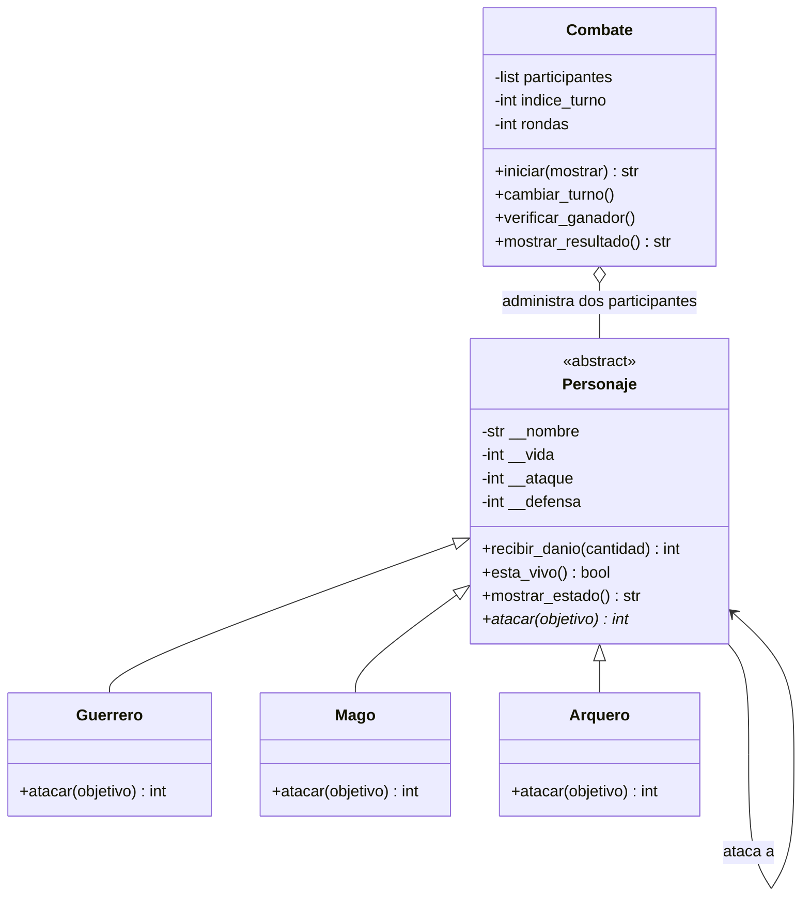

# Guardians of the Ancient Kingdom

Proyecto integrador de Programación Orientada a Objetos con Python: sistema de combate por turnos entre guardianes.

## Estructura

- `personajes.py`: define `Personaje` (clase abstracta), `Guerrero`, `Mago`, `Arquero` y `Combate`.
- `main.py`: contiene demostraciones de las habilidades, validaciones y un combate completo. También incluye pruebas que puede ejecutar Pytest.
- `README.md`: documentación, instrucciones, UML y explicación de las decisiones de diseño.

## Requisitos

- Python 3.10 o posterior.
- Para ejecutar las pruebas automatizadas: `pytest`.

## Ejecución

Desde la carpeta del proyecto:

```bash
python main.py
```

Para ejecutar las pruebas:

```bash
python -m pip install pytest
python -m pytest -q main.py
```

## Responsabilidad de las clases

- **`Personaje`** centraliza los datos y comportamientos comunes. Es abstracta porque no define una fórmula universal para atacar.
- **`Guerrero`** potencia el ataque un 20 %, redondea hacia abajo y luego resta la defensa enemiga.
- **`Mago`** aplica un daño igual a su ataque, sin descontar defensa.
- **`Arquero`** duplica la diferencia entre ataque y defensa cuando el ataque supera la defensa; de lo contrario causa cero daño.
- **`Combate`** administra los turnos, muestra estados, comprueba la victoria y termina en empate técnico si una ronda completa no causa daño o al alcanzar 50 rondas.

## Encapsulamiento y validaciones

Los atributos se exponen mediante propiedades (getters y setters) y se guardan en atributos internos. El nombre no puede estar vacío; vida debe ser un entero de 0 a 100; ataque un entero positivo; defensa un entero no negativo. `recibir_danio()` rechaza daño negativo y limita el daño aplicado a la vida restante. Devuelve el daño realmente aplicado, que puede ser menor que el daño calculado si el objetivo tenía poca vida.

## Relaciones entre clases

- **Herencia:** `Guerrero`, `Mago` y `Arquero` heredan de `Personaje`.
- **Asociación:** cuando un personaje ataca a otro, ambos objetos interactúan.
- **Agregación:** `Combate` recibe personajes creados por separado y los administra; no los construye dentro de su constructor.

## Conceptos de POO

- **Abstracción:** `Personaje` describe lo común sin decidir cómo ataca cada tipo.
- **Encapsulamiento:** las propiedades validan los valores antes de almacenarlos.
- **Herencia:** las subclases reutilizan atributos y métodos de `Personaje`.
- **Polimorfismo:** `Combate` invoca `atacar()` sin comprobar si el participante es Guerrero, Mago o Arquero; cada clase aplica su propia regla.

## Lógica de turnos

Los participantes se alternan. Después de cada ataque se comprueba si hay ganador. Cada ronda intenta permitir un ataque por participante; si la pelea continúa y el daño total de ambos ataques de esa ronda es cero, se declara empate técnico. El límite máximo es de 50 rondas.

## Diagrama de clases UML



El símbolo `*` representa una operación abstracta. La relación de agregación se indica con un rombo vacío en el extremo de `Combate` en la notación UML conceptual; el diagrama Mermaid usa `o--`.

## Reto de abstracción

`atacar()` es abstracto porque no existe una fórmula que represente correctamente a todos los guardianes: el Guerrero aumenta su ataque, el Mago ignora la defensa y el Arquero puede duplicar el daño. La clase base obliga a que todas las subclases implementen esa operación, y el combate puede llamarla de forma polimórfica sin conocer la clase concreta.

En cambio, `recibir_danio()` puede implementarse en `Personaje` porque todos comparten las mismas reglas de aplicación del daño: rechazar cantidades negativas, no bajar de cero de vida y devolver el daño efectivamente aplicado. Las clases hijas reutilizan esta lógica común, evitando duplicación.

## Pruebas incluidas

Las funciones `test_...` de `main.py` comprueban:

- Creación válida y rechazo de atributos incorrectos.
- Cálculo de las tres habilidades.
- Vida no negativa y daño efectivo.
- Prohibición de atacar cuando el personaje está derrotado.
- Empate técnico cuando no se causa daño.
- Identificación del ganador.

Ejecuta `python -m pytest -q main.py` y revisa el resumen de pruebas en la terminal.
